# Movies-Zone

A premium movie discovery app built with Next.js (Pages Router). Browse trending titles, refine the catalog with TMDB-style URL filters, explore regional collections, open detailed movie and cast profiles, search the archive, save favorites, and read the site FAQ — all from one responsive, SEO-friendly app.

> **Yarn only.** Use `yarn install`, `yarn dev`, `yarn lint`, `yarn build`, and `yarn start`. `yarn.lock` is authoritative; do not use npm or reintroduce `package-lock.json`.

---

## Table of contents

- [Highlights](#highlights)
- [Design system](#design-system)
- [Screenshots](#screenshots)
- [Routes](#routes)
- [URL-driven filtering](#url-driven-filtering)
- [Rendering & data flow](#rendering--data-flow)
- [SEO](#seo)
- [Responsive behavior](#responsive-behavior)
- [Tech stack](#tech-stack)
- [Getting started](#getting-started)
- [Environment variables](#environment-variables)
- [Scripts](#scripts)
- [Project structure](#project-structure)
- [Implementation notes](#implementation-notes)
- [Credits](#credits)

---

## Highlights

- **Landing page** — an always-rendered editorial hero with 10 autoplaying trending slides, smooth poster transitions, hover/focus pause, reduced-motion support, centered mobile dots/controls, genre explorer, and a compact teaser that sends readers to the canonical `/movies` library. Only the current and adjacent posters are mounted, so the longer carousel does not download ten images at once. No extra top padding or horizontal scrollbars.
- **Movie library (`/movies`)** — the canonical browse page with TMDB-compatible filters, sort options, URL-persisted state, active filter chips, and shared pagination. Filter and genre tiles deliberately show no counts.
- **Movie details (`/movies/[id]`)** — overview, key crew (one person per priority job first, `MAX_CREW = 8`), cast, similar titles, watch providers, favorite action, and inline trailers.
- **Cast profiles (`/cast/[id]`)** — biography, known-for credits, filterable/sortable filmography, crew work, social/external links, and a photo gallery with lightbox.
- **Image galleries (`/images/[id]`)** — top-aligned `object-cover` tiles that keep faces visible and avoid blank side gutters.
- **Genre pages (`/category/[id]`)** — curated representative titles plus a browsable genre index.
- **Regional specials (`/special/[page]`)** — Hindi, Telugu, Tamil, Malayalam, and Kannada feeds using the same filter stack, with the language locked and `with_origin_country=IN` forced. Pagination uses `p`; invalid slugs return `404`.
- **Search** — debounced input (450 ms on the page, 300 ms in the overlay), URL-synced query, sorting, grid/list views, pagination, empty/error states, and a redesigned command overlay with quick searches and a compact mobile submit.
- **Favorites (`/favorite`)** — reflects the actual saved TMDB account favorites through a shared `FavoritesProvider`, with honest disclosure in the About FAQ that the demo account is shared rather than private.
- **About (`/about`)** — website information, pillars/stats, and an accessible FAQ accordion (single-open, first item open by default, `aria-expanded`, `aria-controls`, `role="region"`).
- **Not-found (`/404`)** — an on-brand editorial 404 with an oversized numeral, inline search that routes to `/search-movies/[name]`, curated detours, and `noindex` SEO.
- **Navigation** — input-like navbar search trigger with `⌘K`, mega-menu, mobile panel that fits the viewport, scrolls when tall, and closes on outside click, Escape, or link selection.
- **Videos** — trailers and clips play inline in a viewport-sized `youtube-nocookie.com` modal, never fullscreen. Escape, outside click, and the close button all dismiss it.
- **Footer** — compact two-column mobile layout, centered social icons, collection links, and the credit `Avinash Potnuru` linking to <https://avinashpotnuruportfolio.netlify.app/> in a new tab.
- **SEO** — per-route title, description, canonical URL, Open Graph/Twitter cards, and JSON-LD (`WebPage`, `FAQPage`, `CollectionPage`, movie and person schemas).
- **Performance** — Redux is no longer mounted in `_app`; RTK Query is scoped through `ApiProvider`, UI state is local React state, and server-only SEO helpers are dynamically imported so they stay out of the client bundle. Current build reports ~107 kB shared First Load JS, ~132 kB on `/`, and ~101 kB on `/about`.

---

## Design system

| Token | Value | Use |
| --- | --- | --- |
| Navy | `#04152d` | Base background, chrome, modals |
| Slate | `#475569` | Secondary text, borders, muted UI |
| Cyan | `#51E5FF` | Primary accent, active states, links |
| Coral-red | `#F4442E` | Alerts, badges, focal accents |

- **Typography:** `Inter` for body copy, `Space Grotesk` for headings, both loaded with `next/font/google` in `src/pages/_app.js`.
- **Visual language:** sharp edges, hairline borders, oversized numerals, restrained motion, asymmetric editorial layouts, and sparing accent color.
- **Imagery:** TMDB image CDN through `next/image` with optimization disabled, so production deployments load poster files directly from TMDB instead of relying on Netlify's `/_ipx` sharp runtime. Posters and profile cards use reliable sizes in both dev and production.

---

## Screenshots

Captured from the running app at **1440 × 900** except the cast mobile view (**390 × 844**). Full-size originals live in [`public/screenshots`](public/screenshots).

<table>
  <tr>
    <td align="center"><b>Landing</b><br><a href="public/screenshots/01-home.png">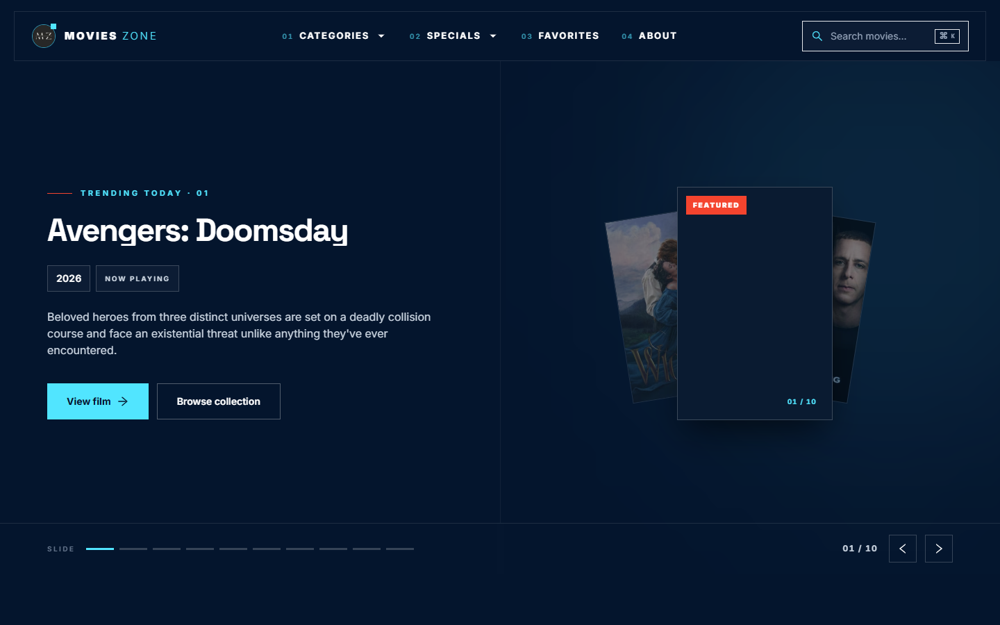</a></td>
    <td align="center"><b>Movie library</b><br><a href="public/screenshots/02-movies.png">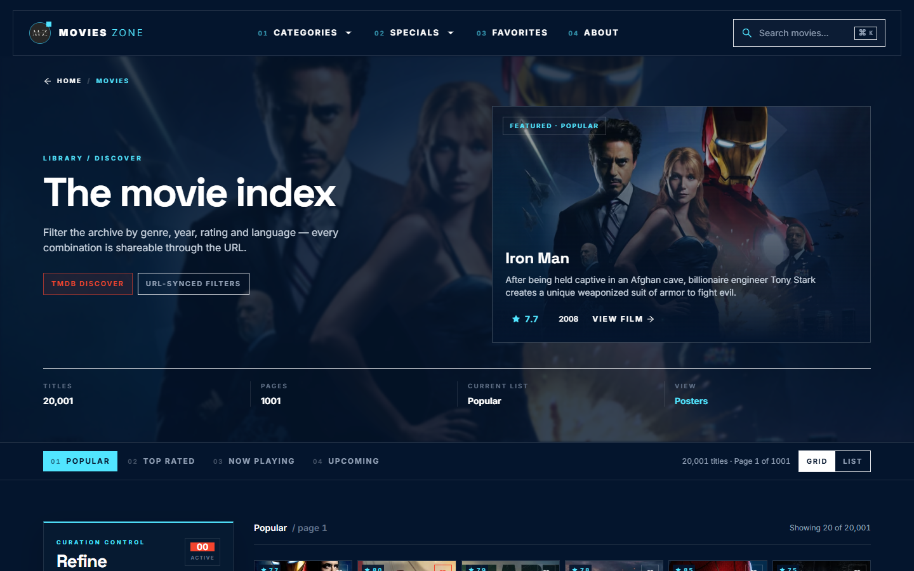</a></td>
  </tr>
  <tr>
    <td align="center"><b>Movie details</b><br><a href="public/screenshots/03-movie-details.png">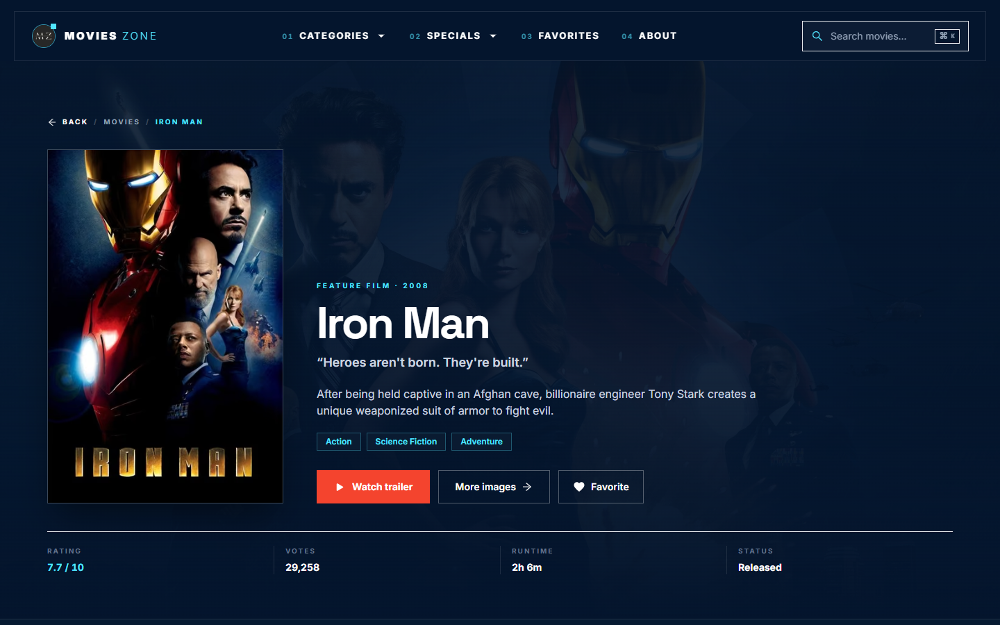</a></td>
    <td align="center"><b>Cast profile</b><br><a href="public/screenshots/04-cast-profile.png">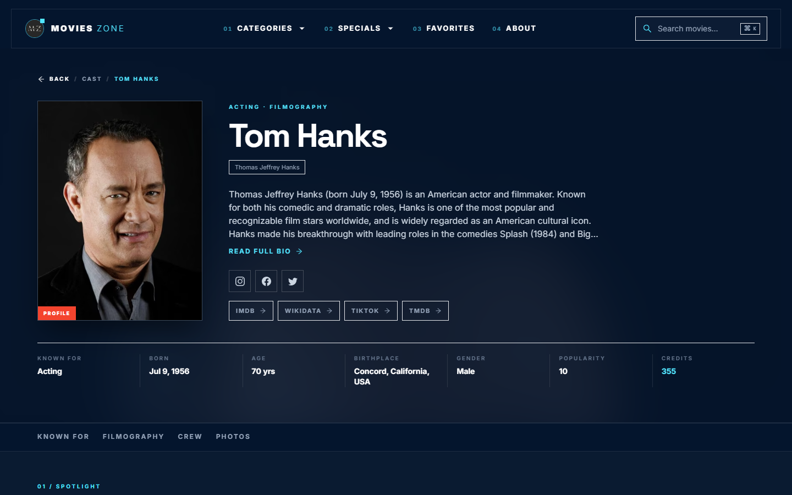</a></td>
  </tr>
  <tr>
    <td align="center"><b>Genre collection</b><br><a href="public/screenshots/05-category.png">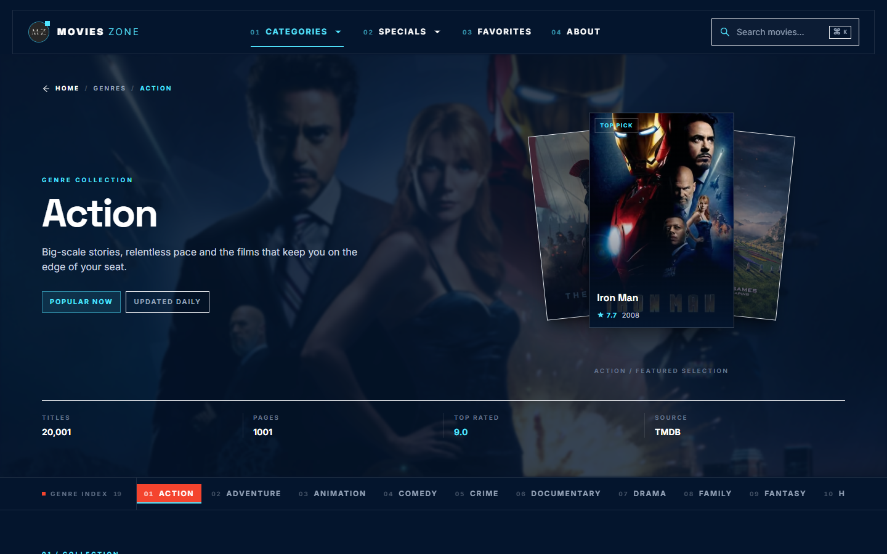</a></td>
    <td align="center"><b>Regional special</b><br><a href="public/screenshots/06-specials.png">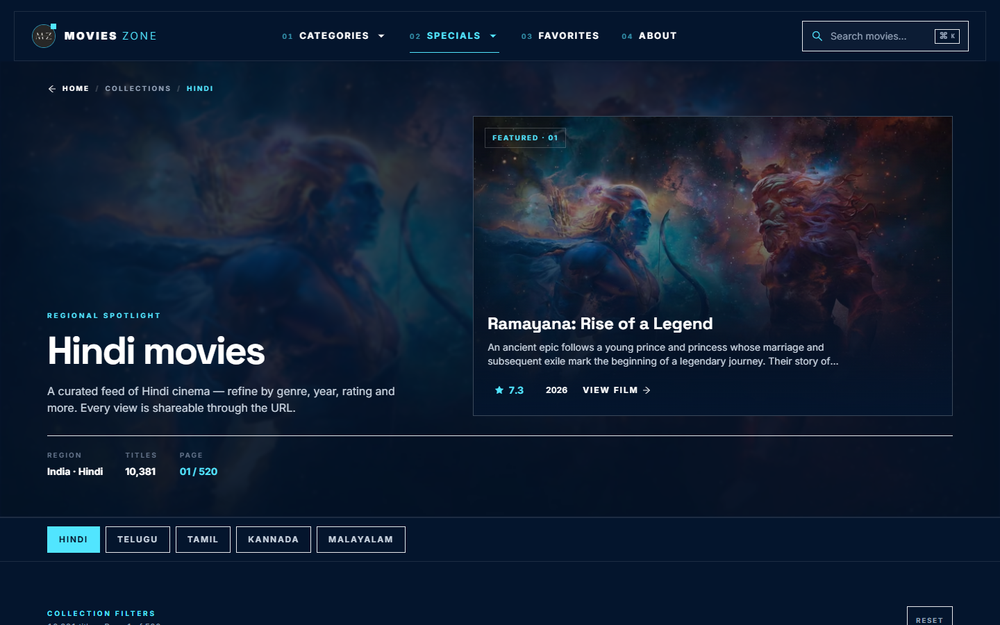</a></td>
  </tr>
  <tr>
    <td align="center"><b>Favorites</b><br><a href="public/screenshots/07-favorites.png">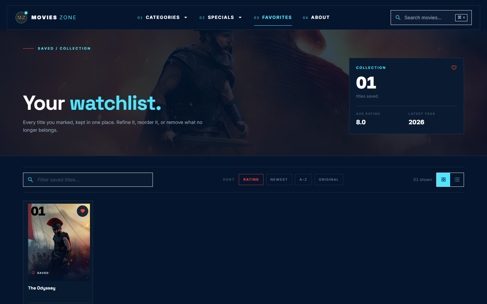</a></td>
    <td align="center"><b>Image gallery</b><br><a href="public/screenshots/08-image-gallery.png">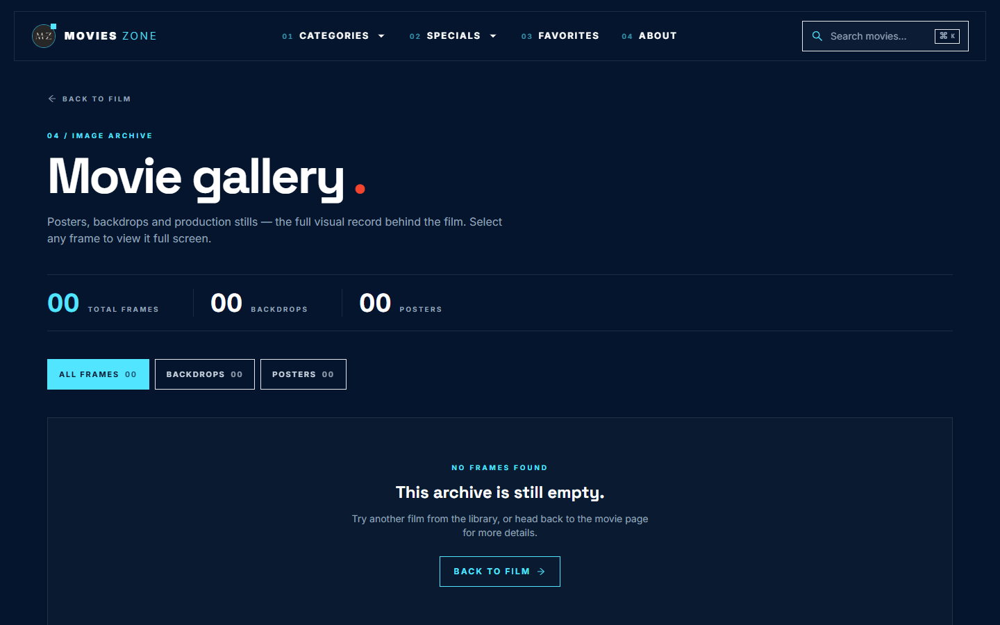</a></td>
  </tr>
  <tr>
    <td align="center"><b>Search results</b><br><a href="public/screenshots/09-search-results.png">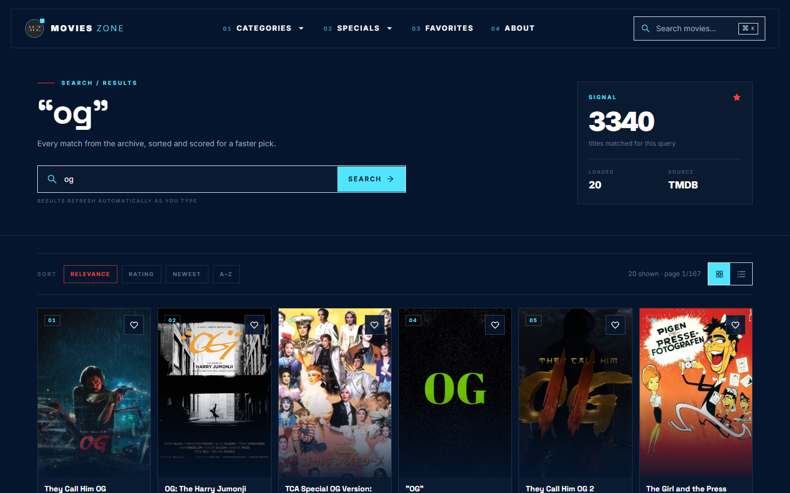</a></td>
    <td align="center"><b>About &amp; FAQ</b><br><a href="public/screenshots/10-about.png">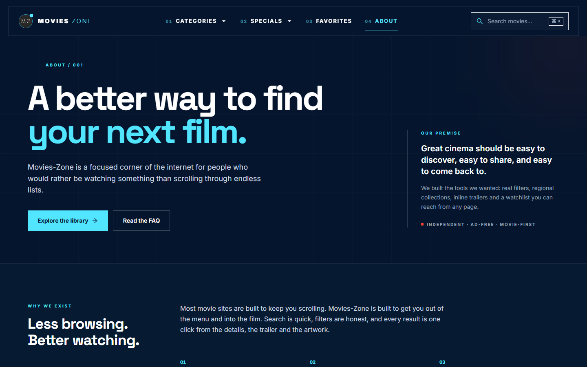</a></td>
  </tr>
  <tr>
    <td align="center"><b>404</b><br><a href="public/screenshots/11-404.png">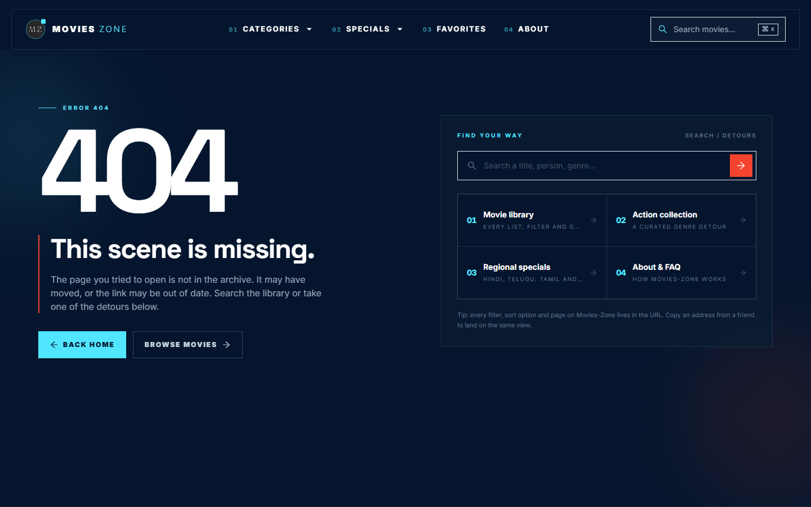</a></td>
    <td align="center"><b>Mobile cast profile</b><br><a href="public/screenshots/12-mobile-cast.png">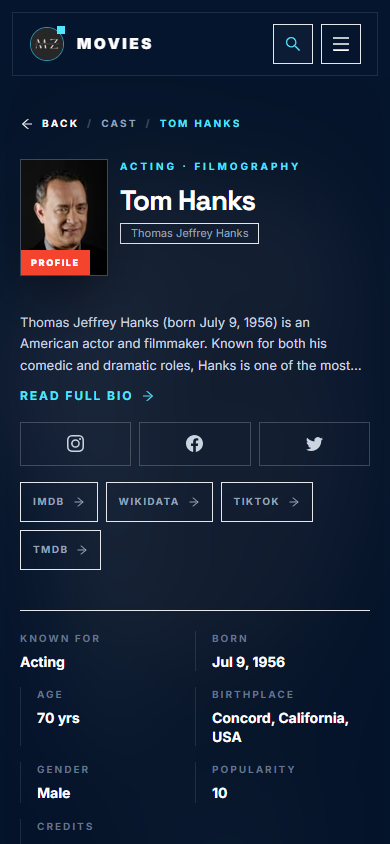</a></td>
  </tr>
</table>

---

## Routes

| Route | Purpose | Rendering |
| --- | --- | --- |
| `/` | Landing hero, genres, teaser library | Static |
| `/about` | Website information and FAQ | Static |
| `/movies` | Canonical movie library with URL filters | Static shell + client data |
| `/movies/[id]` | Movie details, cast, videos, favorites | SSG + ISR |
| `/cast/[id]` | Cast profile, filmography, photos | SSG + ISR |
| `/category/[id]` | Genre collection | SSG + ISR |
| `/special/[page]` | Hindi/Telugu/Tamil/Malayalam/Kannada feeds | SSG + ISR (3600 s) |
| `/images/[id]` | Movie image gallery | SSG + ISR |
| `/search-movies/[name]` | Search results, sorting, views, pagination | SSR |
| `/favorite` | Saved favorites | Static shell + client data |
| `/404` | Not-found page | Static |

---

## URL-driven filtering

Filters are parsed from and written back to the query string, so any view can be copied from the address bar.

| Parameter | Meaning |
| --- | --- |
| `list` | Discover list: `popular`, `top_rated`, `upcoming`, or `custom` |
| `sort_by` | Sort order, e.g. `popularity.desc`, `vote_average.desc`, `title.asc` |
| `with_genres` | Comma-separated genre IDs |
| `primary_release_date.gte` / `.lte` | Release year range (`YYYY-01-01` / `YYYY-12-31`) |
| `vote_average.gte` / `.lte` | Dual-thumb rating range |
| `vote_count.gte` | Minimum vote count |
| `with_original_language` | Original language code |
| `page` / `p` | Page number (`p` on regional specials) |

- Controls use **segmented buttons** and **dual-thumb ranges**; there are no `<select>` elements in the filter panel.
- Active filters render as removable chips via `createFilterChips`.
- Specials reuse the same stack but lock `with_original_language` and always force `with_origin_country=IN`.
- Shared helpers live in `src/components/MovieFilters/constants.js`; API parameter mapping lives in `src/store/api/restApis.js`.

---

## Rendering & data flow

- **Next.js 13.4 Pages Router.** Detail, cast, image, category, and special routes use `getStaticProps` + `getStaticPaths` with ISR; search stays on `getServerSideProps` because it depends on the request URL.
- **Scoped API layer.** `src/components/ApiProvider` wraps only pages that need RTK Query. Redux is not mounted globally in `_app`; ordinary UI state uses `useState`.
- **Favorites.** `FavoritesProvider` centralizes saved-favorite state so cards, detail pages, and `/favorite` stay in sync against the shared demo TMDB account.
- **Server-only SEO.** Dynamic routes import `src/config/seo.js` inside `getStaticProps`/`getServerSideProps`, keeping API helpers out of the browser bundle.
- **Dynamic sections.** Heavy routes such as movies/category/specials load their client shells with `next/dynamic` and a `LoadingRing` fallback.
- **Images.** `next/image` with `unoptimized: true`, explicit `sizes`, TMDB CDN preconnect/dns-prefetch, and object-top crops for profile/gallery faces.

---

## SEO

Every page renders one `src/components/Seo` component. It emits:

- `<title>` suffixed with `— Movies-Zone`
- meta description, robots, and optional keywords
- canonical URL from `absoluteUrl(path)` and `NEXT_PUBLIC_SITE_URL`
- Open Graph type, site name, title, description, URL, image, and image alt
- Twitter `summary_large_image` card with optional site handle
- JSON-LD via `serializeJsonLd`, which escapes `<`, `>`, and `&`

The About page combines `WebPage` and `FAQPage` schemas; movie and person routes emit their own structured data.

---

## Responsive behavior

- Layout top offset matches the navbar height (`pt-[76px] sm:pt-[88px]`) instead of a blanket desktop padding.
- Mobile nav fits 320 px+ viewports, scrolls when tall, and closes on outside click, Escape, or link selection.
- Hero carousel controls, Today/This week toggle, footer socials, and mobile icons are centered.
- Mobile cast header uses a compact 88 px portrait with alias chips near the name, full-width bio/social/external links, and a full-biography modal that never shifts the portrait.
- Desktop cast header keeps its original grid, portrait alignment, stats, sticky offset, inline bio toggle, and alias chips **below** the name (not in the same row).
- Photo gallery and filmography sidebar avoid horizontal overflow down to 320 px.
- Horizontal rows scroll but hide the visible scrollbar; the document itself never scrolls sideways.

---

## Tech stack

- Next.js 13.4.19 (Pages Router)
- React 18.2
- Redux Toolkit + RTK Query (scoped via `ApiProvider`)
- Tailwind CSS 3.3
- `next/image` with direct TMDB CDN delivery
- `next/font/google` for Inter and Space Grotesk
- `react-icons`
- ESLint via `next lint`
- TMDB-backed REST API and image CDN

---

## Getting started

```bash
yarn install --frozen-lockfile
yarn dev
```

Open <http://localhost:3000>.

If a build fails with stale page errors such as `PageNotFoundError` or `Ensure bailed, found path does not match ensure type (pages/app)`, stop the dev server, remove `.next`, and rebuild:

```bash
# Windows PowerShell / CMD
Remove-Item -Recurse -Force .next   # or: rmdir /s /q .next
yarn build
yarn dev
```

Stop the running dev server before `yarn build`; a production build can invalidate the dev server's `.next` output.

---

## Environment variables

Copy `.env.example` to `.env.local` and fill in your values:

```bash
cp .env.example .env.local
```

```env
NEXT_PUBLIC_BACKEND_BASEURL=
NEXT_PUBLIC_BACKEND_BASEURL_API_KEY=
NEXT_PUBLIC_SITE_URL=http://localhost:3000
NEXT_PUBLIC_TWITTER_HANDLE=
```

- The first two point to the TMDB-backed API used by `src/store/api/restApis.js`.
- `NEXT_PUBLIC_SITE_URL` builds canonical and social image URLs; it falls back to `http://localhost:3000`, so set it to the deployed URL on Netlify.
- `NEXT_PUBLIC_TWITTER_HANDLE` is optional.
- `.env.local` is gitignored. Do not overwrite the existing environment files when working in this repository.

---

## Scripts

```bash
yarn dev     # start the development server
yarn lint    # run Next.js ESLint checks
yarn build   # create a production build
yarn start   # serve the production build
```

---

## Project structure

```text
src/
├── components/
│   ├── AboutContent/       # About page content and FAQ accordion
│   ├── ApiProvider/        # Scoped RTK Query provider
│   ├── CastDetails/        # Cast hero, filmography, bio/photo modals
│   ├── Footer/             # Compact responsive footer + portfolio credit
│   ├── HeroBanner/         # Landing hero carousel
│   ├── Layout/             # Navbar, offset, footer shell
│   ├── MovieDetails/       # Details hero, cast, videos, favorites
│   ├── MovieFilters/       # URL filter parsing, chips, controls
│   ├── Movies/             # Shared movie grid, Today/This week toggle
│   ├── Navbar/             # Mega-menu, search trigger, mobile panel
│   ├── Pagination/         # Shared pagination
│   ├── SearchOverlay/      # ⌘K command search dialog
│   ├── Seo/                # Per-page head tags and JSON-LD
│   └── ...
├── config/
│   ├── about.js            # About copy and FAQs
│   ├── collections.js      # Regional specials config
│   ├── seo.js              # Server-only metadata helpers
│   └── site.js             # Site constants and URL/JSON-LD helpers
├── hooks/
│   ├── useDebounce.js
│   └── useFavoriteToggle.js  # FavoritesProvider
├── pages/                  # Routes listed above
├── store/api/restApis.js   # RTK Query endpoints and param mapping
├── styles/globals.css
└── utilities.js
public/
└── screenshots/            # README screenshots
```

---

## Implementation notes

- **Protected UI:** avoid silent structural changes to the navbar, landing hero, global top offset, or the original desktop cast header.
- The homepage is intentionally a compact teaser; `/movies` is the canonical full library.
- The desktop cast bio uses the original inline **Read full bio / Show less** toggle; only the mobile cast header opens the biography modal.
- Key crew selects one person per priority job before filling remaining slots.
- Invalid `/special/[page]` slugs must return `404`.
- Browserlist/caniuse-lite warnings during `yarn build` are harmless.
- `yarn build` kills a running dev server; restart with `yarn dev`.
- `yarn.lock` is authoritative and `package-lock.json` is intentionally absent.
- Favorites currently write to a shared demo TMDB account; this is disclosed in the About FAQ and should not be described as private per-user storage.

---

## Credits

- Movie data, imagery, and video metadata by [The Movie Database (TMDB)](https://www.themoviedb.org/). Movies-Zone is not affiliated with or endorsed by TMDB.
- Built by [Avinash Potnuru](https://avinashpotnuruportfolio.netlify.app/).
